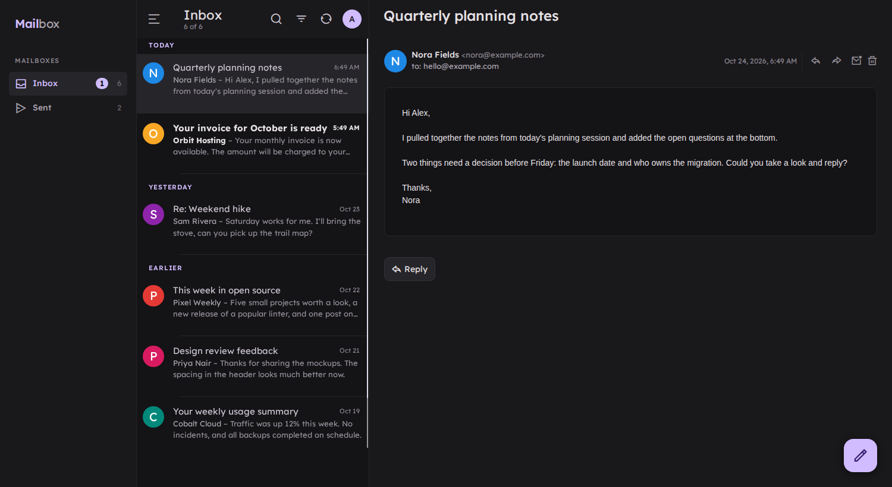
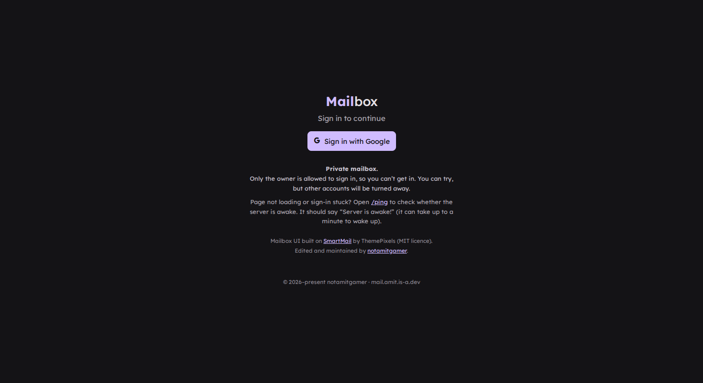
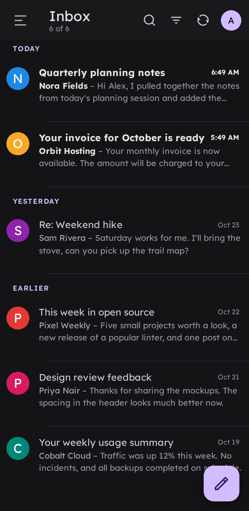
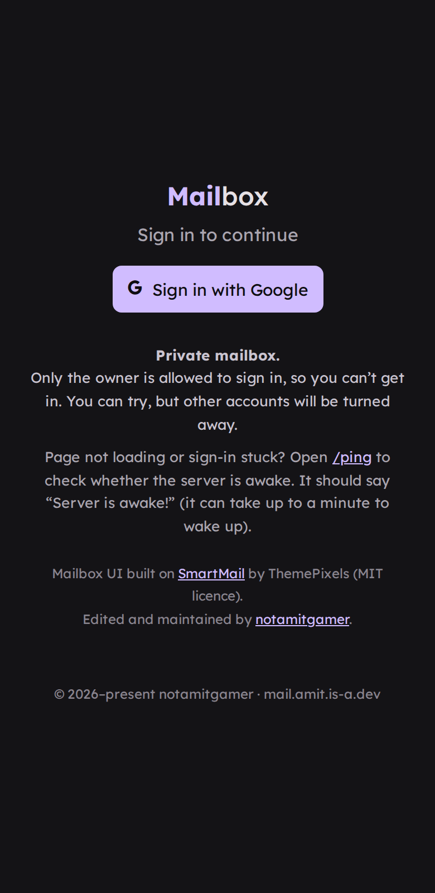

<p align="center">
  
</p>

<h1 align="center">mail-server</h1>

<p align="center">
  A small, self-hosted mailbox for your own domain, with push notifications.
</p>

<p align="center">
  <a href="LICENSE"></a>
  
  <a href="https://docs.amit.is-a.dev/mail-server"></a>
</p>

[Resend](https://resend.com) receives the mail, the server stores it in [Firebase Firestore](https://firebase.google.com/docs/firestore), and an installable web app lets you read, reply, forward and send, with push notifications for new mail. Nothing is forwarded to a third-party inbox.

## Screenshots

Shown with made-up demo mail.

**Desktop**

<table>
  <tr>
    <td align="center"><br><sub>Signed in</sub></td>
    <td align="center"><br><sub>Signed out</sub></td>
  </tr>
</table>

**Mobile**

<table>
  <tr>
    <td align="center"><br><sub>Signed in</sub></td>
    <td align="center"><br><sub>Signed out</sub></td>
  </tr>
</table>

## Features

- Receives mail through a Resend webhook and keeps it in your own Firestore database
- Mobile-first web app (PWA) with offline cache, swipe actions and pull to refresh
- Reply, forward and compose from your own addresses
- All / Unread filter, one-click reader actions and keyboard shortcuts (`j`/`k` move, `r` reply, `c` compose, `/` search)
- Web Push notifications that open the message straight away
- Single-owner by design: sign in with one Google account

## Quick start

You need a domain on Resend with inbound mail enabled, a Firebase project (Firestore and Google sign-in) and Node.js 18 or newer.

```bash
git clone https://github.com/notamitgamer/mail-server.git
cd mail-server
npm install
cp .env.example .env     # then fill in the values
node --env-file=.env server.js   # Node 20.6+; or export the variables and run: npm start
```

The app is served at `http://localhost:3000`. For production, deploy it as a Node web service (for example on Render) with the same variables, build command `npm install`, start command `npm start` and health check path `/ping`.

## Documentation

Step-by-step setup, every environment variable, usage and the API reference live in the docs:
**https://docs.amit.is-a.dev/mail-server**

## Contributing and security

Issues and pull requests are welcome. Please report security problems privately, as described in [SECURITY.md](SECURITY.md).

## License

[MIT](LICENSE) © Amit Dutta. The interface is based on the MIT-licensed [SmartMail](https://github.com/themepixels/smartmail) template by ThemePixels, and the app bundles other open-source libraries. Their licenses and credits are in [THIRD_PARTY_NOTICES.md](THIRD_PARTY_NOTICES.md).
